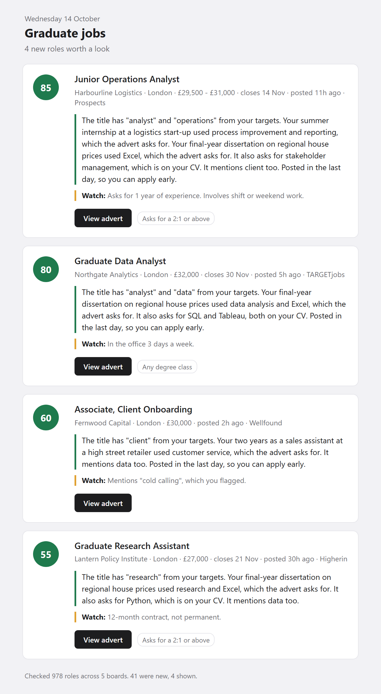

# Graduate job digest

A daily digest of new graduate jobs from UK job boards, ranked by keywords you
choose. It reads the boards, keeps only roles you have not seen before, and
writes a short HTML page. It can email that page to you too. Each job says
why it fits: your target words in the title, the past jobs and projects whose
skills the advert asks for, and other skills from your CV. A Watch line flags
downsides found in the advert, such as a fixed-term contract or years of
experience required.



*Example digest. The employers, roles and profile are made up.*

Five boards work out of the box with no API keys, no accounts and no cost.
LinkedIn is optional and needs a free Apify account. Python 3.9 or later.

## Why

Graduate roles fill fast, and checking six job boards every morning is
tedious. This checks them for you and shows only what is new since the last
run.

## Quick start

New to Python or the command line? Skip to the
[step-by-step setup](#step-by-step-setup) below.

```
git clone https://github.com/Horatio-Eversfield/grad-job-digest.git
cd grad-job-digest
pip install -r requirements.txt
cp profile.example.yaml profile.yaml      # Windows: copy. Then add your keywords
python digest.py --dry-run
```

Open `digest.html` to see the result. When you are happy with it, drop
`--dry-run`, so each run remembers what it has shown.

The first run shows roles posted in the last 48 hours. After that, each run
shows only roles that are new since the run before. If you miss a few days,
the next run catches up, up to a week.

## Step-by-step setup

No coding needed. Takes about ten minutes, once.

**1. Install Python.** Download it from
[python.org/downloads](https://www.python.org/downloads/) and run the
installer. On Windows, tick "Add python.exe to PATH" on the first screen.

**2. Download this tool.** At the top of this page, click the green **Code**
button, then **Download ZIP**. Unzip it somewhere easy to find, such as your
Documents folder.

**3. Open a command window in that folder.**

- Windows: open the unzipped folder in File Explorer. Click the address bar
  at the top, type `cmd` and press Enter.
- Mac: open the Terminal app. Type `cd ` with a space after it, drag the
  unzipped folder onto the Terminal window, and press Enter.

**4. Install what it needs.** Type this and press Enter:

| Windows | Mac |
|---|---|
| `py -m pip install -r requirements.txt` | `python3 -m pip install -r requirements.txt` |

**5. Create your profile.** Type this and press Enter:

| Windows | Mac |
|---|---|
| `copy profile.example.yaml profile.yaml` | `cp profile.example.yaml profile.yaml` |

**6. Add your keywords.** Right-click `profile.yaml` and open it with
Notepad (Windows) or TextEdit (Mac). Under `keywords`, replace the examples with words for the jobs
you want, one per line, each starting with `  - ` as shown. Under `avoid`,
list title words that rule a job out. Under `skills`, list skills and tools
from your CV, such as Excel or customer service. Under `experience`, add
past jobs, internships or projects, each with the skills it used. Under
`watch_for`, list anything you want warned about, such as cold calling.
Optionally set `degree_class` and `russell_group` (see
[Degree class and university](#degree-class-and-university-optional)). Save the file.

**7. Run it.** Type this and press Enter:

| Windows | Mac |
|---|---|
| `py digest.py` | `python3 digest.py` |

It takes a minute or two. Then double-click `digest.html` in the folder to
see your jobs. Run the same command each morning, or set it to run itself:
see [Run it every morning](#run-it-every-morning). To get the digest by
email, see [Email](#email-optional).

**If something goes wrong:**

- `'py' is not recognized` or `command not found`: Python is not installed,
  or on Windows the PATH box was not ticked. Run the installer again.
- `profile.yaml not found`: step 5 was missed, or the command window is not
  in the tool's folder. Repeat step 3.
- Nothing shown: your keywords may be too narrow. Add more, or lower
  `min_score` in `config.yaml`.

## Files you edit

| File | What it controls |
|---|---|
| `profile.yaml` | Keywords you want, skills and experience from your CV, words to warn about, title words that rule a role out, and your degree class and university (optional) |
| `config.yaml` | City, how many roles, score cut-off, boards, role types |
| `.env` | Email and LinkedIn settings, both optional. Copy from `.env.example` |

`profile.yaml` and `.env` are gitignored, so your own settings are never
committed.

## How roles are scored

Each role scores 0 to 100:

- 40 for a keyword in the job title, plus 10 for each further title keyword,
  up to 60.
- 5 for each keyword or skill (including skills under `experience`) found
  only in the advert text, up to 30.
- 10 if it was posted in the last 24 hours.
- 0 if its title contains an `avoid` word.

Roles below `min_score` in `config.yaml` are left out. With no keywords at
all, the digest shows the newest roles instead.

Under each job, the email explains its score in plain words, from the same
matches: the target words in the title, the experience whose skills the
advert asks for, other skills from your CV, other keywords it mentions, and
whether it is under a day old.

A Watch line under that lists downsides read from the advert: years of
experience asked for, a fixed-term or temporary contract, days in the office,
commission, a driving licence, shift or weekend work, unpaid work, and any of
your `watch_for` words. These never change the score or hide a role. They are
found by matching set phrases, so a downside worded another way is missed.
Milkround gives only a short snippet of each advert, so its roles get fewer
reasons and warnings.

## Degree class and university (optional)

### Degree class

Set `degree_class` in `profile.yaml` to `first`, `2:1`, `2:2` or `third`, and
roles whose advert asks for a higher class are hidden. The digest footer says
how many. Leave it blank to see everything.

The class is read from the advert text, so it leans towards showing a role.
When an advert names more than one class, the lowest counts. "2:1 not
required" counts as no minimum. Adverts that never mention a class are shown,
unless you set `hide_if_class_not_stated: true`.

### Russell Group

Some employers only take graduates from Russell Group universities, the 24
UK research universities listed at russellgroup.ac.uk. If you did not study
at one, set `russell_group: no` in `profile.yaml`. Roles whose advert
requires a Russell Group degree are then hidden, and the footer says how
many. Leave it blank, or set it to `yes`, to hide nothing.

Only the phrase "Russell Group" counts, so "FTSE Russell" and similar names
are ignored. A role that only prefers a Russell Group degree ("ideally",
"desirable") is never hidden. It gets a note under the job instead. Few
adverts state this: about 1 in 600 London roles in October 2026.

## Sources

| Board | What is read | Posting date | Setup |
|---|---|---|---|
| TARGETjobs | Every open graduate role for the city | Exact, from the listing | None |
| Milkround | First page of several searches | Exact, from the listing | None |
| Higherin | Graduate roles for the city, newest first | From each job page | None |
| Prospects | Every graduate role for the city | From each job page | None |
| Wellfound | First page of several startup role pages | Exact, from the listing | None |
| LinkedIn | A logged-out job search, through Apify | Exact, from the listing | Free Apify account, off by default |

Wellfound is not a graduate board. Roles that are plainly senior are left
out: a senior title word, two or more years' experience asked for, or an
internship.

Bright Network is not included. It blocks automated readers, including
headless browsers, so the only way to read it is by hand. It is worth
checking yourself.

Each board is read with a few polite requests, with pauses, within what its
robots.txt allows. This is a personal tool for one person's job search. Do
not use it to copy the boards' listings in bulk, run it every few minutes, or
republish what it collects. Check each board's terms yourself.

Boards change their pages without warning. When one breaks, its count in the
digest footer drops to zero and the footer names the error. The fix is in
that board's function in `sources.py`. Pull requests welcome.

## Email (optional)

1. Copy `.env.example` to `.env`.
2. For Gmail, turn on 2-step verification and create an app password at
   myaccount.google.com/apppasswords. Use a spare Gmail account as the
   sender if you can: an app password opens the whole mailbox.
3. Fill in `SMTP_USER`, `SMTP_PASSWORD` and `EMAIL_TO`.

If an email fails to send, nothing is marked seen, so the next run includes
those roles again.

## LinkedIn (optional)

LinkedIn does not allow crawlers, so this tool never reads it directly. It
uses Apify's [LinkedIn job search Actor](https://apify.com/harvestapi/linkedin-job-search),
which searches as a logged-out visitor. Your LinkedIn account is never used.

1. Sign up at apify.com. The free plan gives $5 of credit a month.
2. Copy your API token from console.apify.com/settings/integrations into
   `APIFY_TOKEN` in `.env`.
3. Set `linkedin: true` under `sources` in `config.yaml`.

Each role found costs about $0.001, so a typical daily run costs a few
cents. `max_charge_usd` in `config.yaml` caps every run, and Apify enforces
it. The first run may ask you to approve the Actor in the Apify console.

## Run it every morning

macOS or Linux, with cron (`crontab -e`), every day at 7am:

```
0 7 * * * cd /path/to/grad-job-digest && python3 digest.py
```

Windows:

1. Open the Start menu, type **Task Scheduler** and open it.
2. Click **Create Basic Task**. Name it "Graduate job digest".
3. Choose **Daily** and pick a time, such as 7:00.
4. Choose **Start a program**. In **Program/script** type `py`. In
   **Add arguments** type `digest.py`. In **Start in** paste the full path of
   this folder, for example `C:\Users\you\Documents\grad-job-digest`.
5. Click **Finish**.

The computer must be on at that time. If it was off, the next run catches
up.

## Commands

```
python digest.py              # read, score, write digest.html, email, mark seen
python digest.py --dry-run    # same, but send nothing and mark nothing seen
python digest.py --backfill   # mark every open role seen without sending. Use to start fresh
```

## Ideas for extending it

- Swap `score()` in `digest.py` for something smarter, such as an LLM that
  reads your CV.
- Add a board: write a reader in `sources.py` that returns rows in the shape
  shown at the top of that file, and add it to `fetch_all()`.

## Licence

MIT. See `LICENSE`.
